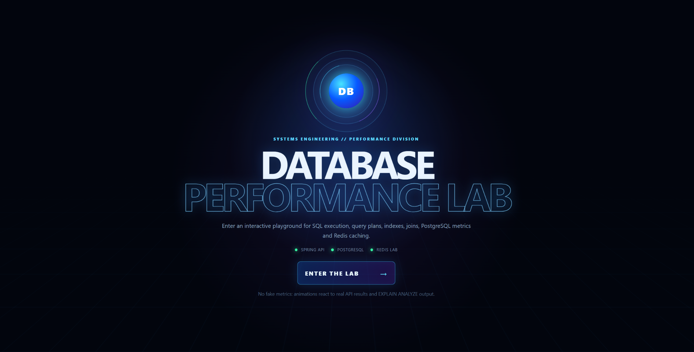
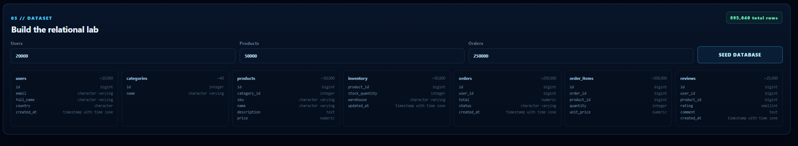
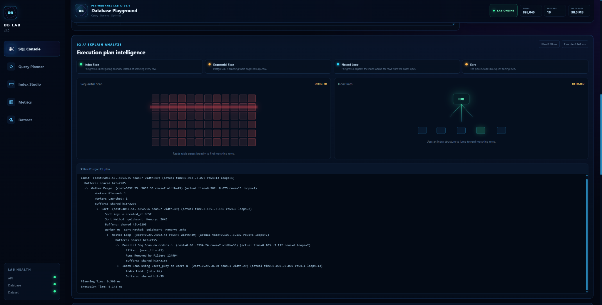
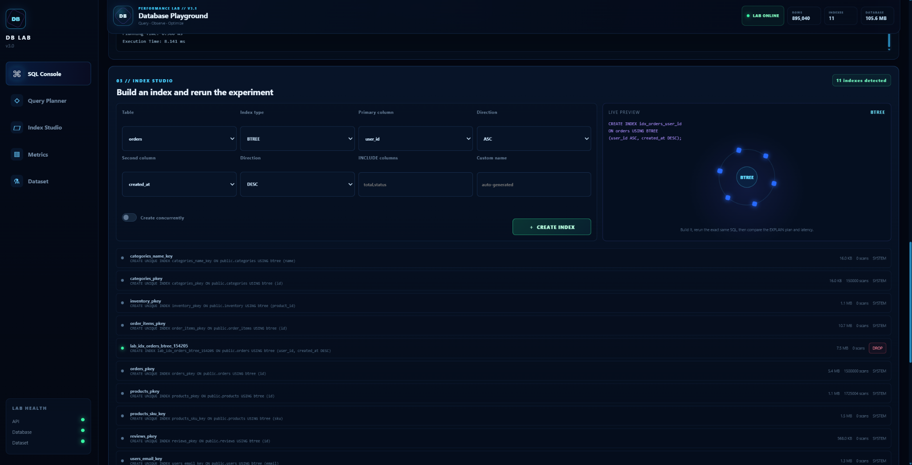
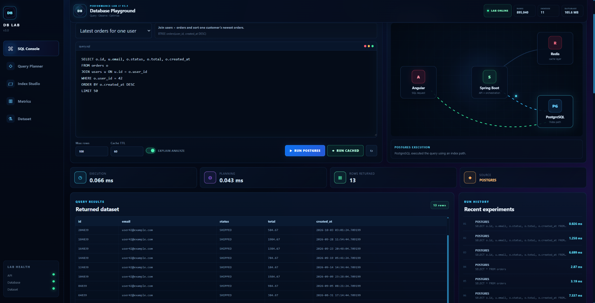
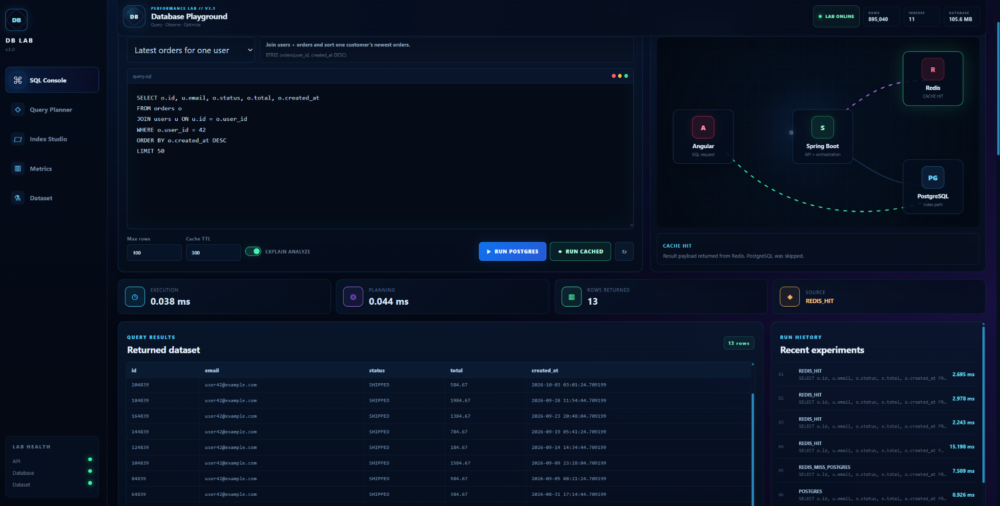
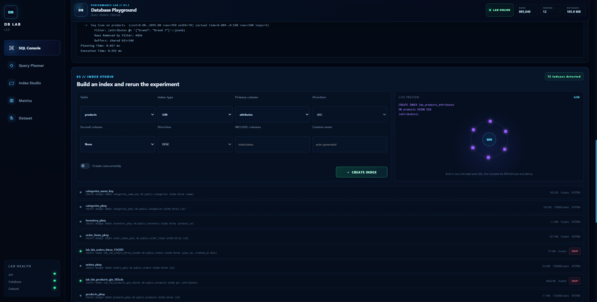
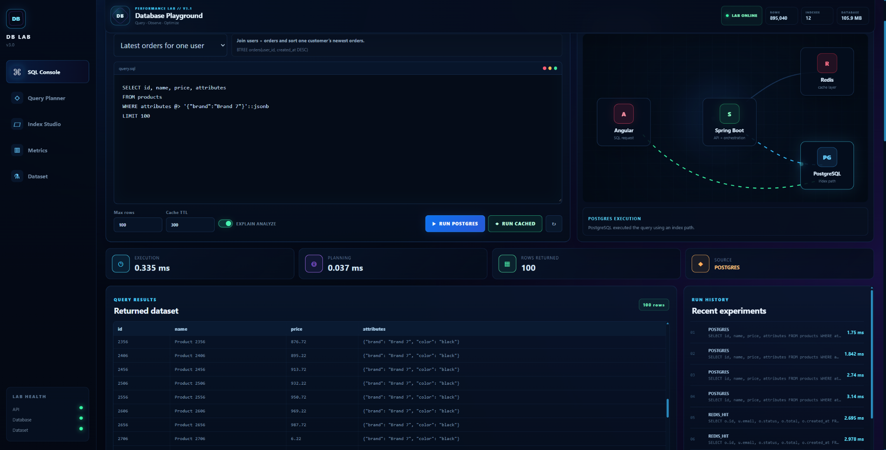
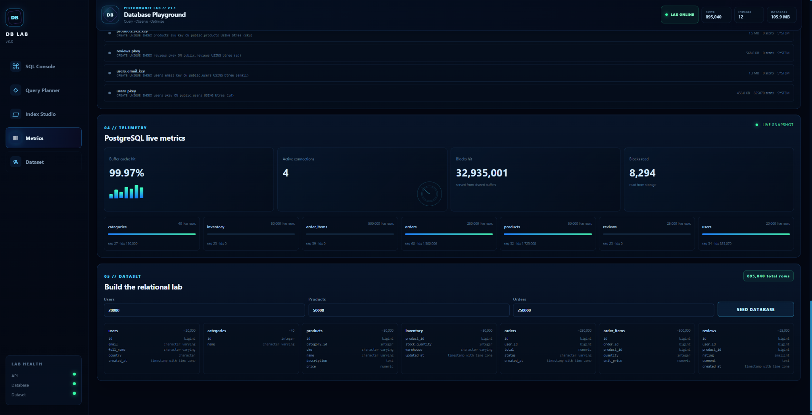

# Database Performance Playground v3

A portfolio project for experimenting with PostgreSQL query plans, joins, index strategies and Redis caching from a Spring Boot + Angular application.



## Stack

- Java 21
- Spring Boot 4.1.1
- Spring JDBC
- PostgreSQL 17
- Redis 7.4
- Angular 22.2.x
- TypeScript 6.0.x
- Docker Compose
- Spring Boot Actuator + Prometheus endpoint

## What v3 adds

V3 keeps the full v2 performance playground and adds an animated lab interface. The animation is wired to real backend results rather than random decoration:

- cinematic “Enter the Lab” landing screen
- animated Angular → Spring Boot → Redis/PostgreSQL request map
- cache-hit, cache-miss and direct-PostgreSQL paths illuminate differently
- SQL execution metrics animate into a heads-up-display style dashboard
- EXPLAIN ANALYZE is interpreted into plan signals such as `Seq Scan`, `Index Scan`, `Hash Join`, `Nested Loop`, `Sort` and `Aggregate`
- plan-aware sequential-scan and index-path visualizations
- animated Index Studio with a live SQL preview
- PostgreSQL telemetry and per-table sequential/index scan ratios
- responsive desktop/tablet/mobile layout
- no extra animation dependency: the visual system is native Angular + CSS/SVG, so the backend/API contract remains unchanged

The underlying lab still includes:

- custom read-only SQL console (`SELECT` and read-only `WITH`)
- query result table
- `EXPLAIN (ANALYZE, BUFFERS)` output
- planning time and execution time
- run history for comparisons
- Redis caching for arbitrary SQL
- dynamic index builder
- B-tree, Hash, GIN, GiST and BRIN choices
- composite B-tree indexes with ASC/DESC
- B-tree `INCLUDE` columns
- optional `CREATE INDEX CONCURRENTLY`
- live index catalog, index size and scan count
- PostgreSQL cache-hit ratio and table scan metrics
- realistic relational schema with joins

## Demo walkthrough

DB-Lab is designed around repeatable database experiments: keep the SQL and dataset stable, change the physical access strategy, then compare the PostgreSQL execution plan and measured behavior.

### 1. Build a reproducible dataset

The lab generates a relational PostgreSQL dataset with users, products, orders, inventory, order items, categories and reviews.

The default benchmark creates roughly 895,000 rows across the schema.



### 2. Inspect the baseline execution plan

Start with the **Latest orders for one user** workload and run it with `EXPLAIN ANALYZE`.

Before adding the custom composite index, PostgreSQL can scan the `orders` relation broadly while still using existing indexes elsewhere in the join.



The important point is not simply the execution time. The execution plan shows which access strategies PostgreSQL selected for each part of the query.

### 3. Create a composite B-tree index

Index Studio can build indexes without leaving the experiment interface.

For this workload:

```sql
CREATE INDEX ...
ON orders USING BTREE
(user_id ASC, created_at DESC);
```



The exact same SQL can then be executed again and compared with the baseline.

### 4. Rerun the same workload

After adding the composite index, PostgreSQL can use the new index path for the order lookup.



The central workflow is:

```text
same SQL
    ↓
baseline execution plan
    ↓
change indexing strategy
    ↓
rerun EXPLAIN ANALYZE
    ↓
compare plan + latency
```

Measured timings depend on hardware, PostgreSQL cache state and the generated dataset, so DB-Lab exposes the real values instead of presenting fixed benchmark claims.

### 5. Compare PostgreSQL execution with Redis caching

The same query can also be executed through the Redis caching path.

On a cache miss:

```text
Angular
   ↓
Spring Boot
   ↓
Redis MISS
   ↓
PostgreSQL
   ↓
Redis
```

On a cache hit, the stored result is returned without executing PostgreSQL again.



The interface reports the source explicitly as `REDIS_MISS_POSTGRES`, `REDIS_HIT` or `POSTGRES`.

### 6. Experiment with GIN and JSONB

The playground is not limited to B-tree indexes. PostgreSQL-specific workloads include array and JSONB containment queries.

For example:

```sql
SELECT id, name, price, attributes
FROM products
WHERE attributes @> '{"brand":"Brand 7"}'::jsonb
LIMIT 100;
```

A GIN index can be created directly from Index Studio:

```sql
CREATE INDEX ...
ON products USING GIN (attributes);
```



The query can then be rerun to inspect whether PostgreSQL selects the GIN-backed access path.



### 7. Observe PostgreSQL telemetry

After the experiments, the Metrics view exposes PostgreSQL statistics such as buffer cache hit ratio, blocks served from shared buffers, blocks read from storage, connections and sequential/index scan activity.



## Schema

```text
users
  └── orders
        └── order_items ── products ── categories
                          ├── inventory
                          └── reviews ── users
```

Tables:

- `users`
- `categories`
- `products`
- `inventory`
- `orders`
- `order_items`
- `reviews`

`products` also has a `TEXT[] tags` column and a `JSONB attributes` column so GIN indexes have realistic use cases.

## Run locally: recommended development setup

Run only PostgreSQL and Redis in Docker:

```powershell
docker compose up -d postgres redis
```

Start Spring Boot in another terminal:

```powershell
cd backend
mvn spring-boot:run
```

Backend:

```text
http://localhost:8080
http://localhost:8080/actuator/health
```

Start Angular in another terminal:

```powershell
cd frontend
npm install
npm start
```

Frontend:

```text
http://localhost:4200
```

The Angular dev proxy forwards `/api` requests to Spring Boot on port `8080`.

## Important if upgrading from the first MVP

Version 3 uses the same expanded relational model introduced in v2. The cleanest first run is to recreate the development database volume:

```powershell
docker compose down -v

docker compose up -d postgres redis
```

`-v` deletes the existing local PostgreSQL volume, so only use it if you do not need the old lab data.

The seed operation also removes indexes created by this playground and the fixed legacy MVP index so a new benchmark starts from a clean state.

## First experiment

1. Seed the default dataset.
2. Load **Latest orders for one user**.
3. Run PostgreSQL with no custom index.
4. Save the latency and inspect `EXPLAIN ANALYZE`.
5. In Index Studio create:

```text
Method: BTREE
Table: orders
Column 1: user_id ASC
Column 2: created_at DESC
```

6. Run the exact same SQL again.
7. Compare plan and execution time.

You are looking for the planner to move from a sequential-scan/sort strategy toward an index-driven strategy.

## Join experiment

Use the **Top-selling products** preset:

```sql
SELECT p.id, p.name, c.name AS category,
       SUM(oi.quantity) AS units,
       SUM(oi.quantity * oi.unit_price) AS revenue
FROM order_items oi
JOIN products p ON p.id = oi.product_id
JOIN categories c ON c.id = p.category_id
GROUP BY p.id, p.name, c.name
ORDER BY revenue DESC
LIMIT 25;
```

Create/drop indexes such as:

```text
BTREE order_items(product_id)
BTREE products(category_id)
```

Then compare plans and scan counters.

## GIN experiment

Load **Products by tag (GIN)**:

```sql
SELECT id, name, price, tags
FROM products
WHERE tags @> ARRAY['sale']
ORDER BY id
LIMIT 100;
```

Create:

```text
Method: GIN
Table: products
Column: tags
```

You can also experiment with `products.attributes`, which is JSONB.

## BRIN experiment

The generated `orders.created_at` values are physically correlated with insertion order. This makes the **Recent order window** preset useful for comparing a BRIN index with no index or a B-tree index.

Create:

```text
Method: BRIN
Table: orders
Column: created_at
```

BRIN indexes are compact and can be effective on very large naturally ordered tables.

## Redis experiment

1. Click **Clear Redis**.
2. Click **Run cached**.
3. Source should be `REDIS_MISS_POSTGRES`.
4. Click **Run cached** again before the TTL expires.
5. Source should be `REDIS_HIT`.

The Redis key is based on a SHA-256 hash of the SQL plus query options. A cache hit returns the stored payload without executing PostgreSQL again.

## SQL console safety

The browser SQL console intentionally accepts only read operations. The backend:

- allows `SELECT` and read-only `WITH`
- rejects multiple SQL statements
- blocks mutating DDL/DML keywords
- blocks dangerous functions such as `pg_sleep`, `pg_read_file` and backend termination functions
- opens a read-only JDBC transaction
- applies a 12-second statement timeout
- caps displayed rows at 500

Index creation is handled by a separate validated endpoint that only works with known lab tables and columns.

This is defense-in-depth for a local lab; it should not be treated as a general-purpose SQL sandbox for untrusted public users.

## Index methods available

| Method | Good experiments |
| --- | --- |
| B-tree | equality, ranges, joins, sorting, composite indexes |
| Hash | single-column equality lookups |
| GIN | arrays and JSONB containment |
| GiST | generalized search/operator classes; `btree_gist` is enabled for lab scalar experiments |
| BRIN | huge tables where physical row order correlates with the indexed value |

PostgreSQL may reject an index/data-type combination that has no compatible operator class. The UI surfaces the database error instead of hiding it, because compatibility is part of the experiment.

## API

```text
POST   /api/lab/seed
GET    /api/lab/schema
GET    /api/lab/counts
GET    /api/lab/metrics
POST   /api/lab/sql/run
POST   /api/lab/sql/cached
DELETE /api/lab/sql/cache
GET    /api/lab/indexes
POST   /api/lab/indexes
DELETE /api/lab/indexes/{name}
```

Example SQL request:

```json
{
  "sql": "SELECT * FROM orders WHERE user_id = 42 ORDER BY created_at DESC LIMIT 50",
  "maxRows": 100,
  "explainAnalyze": true,
  "cacheTtlSeconds": 60
}
```

## Smoke test

After PostgreSQL, Redis and Spring Boot are running:

```powershell
./scripts/smoke-test.ps1
```

The script checks schema access, seeds a small dataset, runs SQL, creates an index, then verifies a Redis miss followed by a Redis hit.

## Full Docker mode

You can also run the entire stack in containers:

```powershell
docker compose up --build
```

Then open:

```text
http://localhost:4200
```

## Portfolio story

The project is intentionally built around reproducible experiments rather than CRUD. A strong demo is to keep the SQL unchanged while changing only the physical access strategy, then show:

```text
same SQL
  -> no custom index
  -> B-tree / composite index
  -> alternative index type
  -> Redis miss
  -> Redis hit
```

For each run, discuss the query plan, latency, database buffer behavior, index size, and trade-offs such as extra write cost or index storage.
